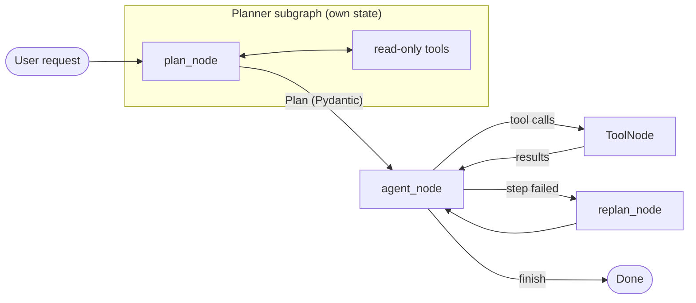

# Local AI Coding Agent

An autonomous coding agent built with **LangGraph** that plans a task, then reads, edits, runs and tests code in a loop. It runs entirely on your own machine using a local open-weight model through **Ollama**, so you don't need a cloud API or API key.

> **Status: work in progress.** The tool layer (44 tools) and core modules are done and tested. The agent graph and planner are being built now. See [Roadmap](#roadmap).

## How it works



1. **The planner** turns the request into a structured `Plan`: a list of `PlanStep`s, validated with Pydantic. It runs as its own LangGraph subgraph, with read-only tools so it can look around the code before planning.
2. **The agent** works through the plan step by step. Each step it either calls tools or calls `finish`.
3. **The tools** run, and their results go back to the agent. Errors come back as plain text, so the model can recover from them.
4. **Replanning:** if a step fails, the plan is updated and the agent continues from there.
5. **An iteration cap** stops the loop if the model gets stuck.

## Tools

| Module | Tools |
|---|---|
| `Code/code_reading.py` | `read_file`, `find_files`, `search_code`, `file_tree`, `get_symbols` |
| `Code/code_editing.py` | `write_file`, `edit_file`, `insert_lines`, `apply_patch`, `undo_edit` |
| `Code/code_execution.py` | `run_python`, `run_tests` (pytest), `lint` (ruff), `type_check` (mypy), `format_code`, `install_package`, `list_packages` |
| `VersionControl/git_tools.py` | `git_status`, `git_diff`, `git_log`, `git_commit`, `git_branch`, `git_checkout` |
| `Research/web_tools.py` | `web_search` (Tavily), `fetch_url`, `python_docs` |
| `Memory/memory_tools.py` | `remember`, `recall`, `ask_user`, `todo_write`, `todo_read`, `finish` |
| `Terminal/` | files (`cp`, `mv`, `cat`, `head`, `grep`), system (`cd`, `pwd`, `ls`, `mkdir`, `rm`), network (`ping`, `ipconfig`, `netstat`), processes (`ps`, `top`, `kill`) |

Every tool and argument has a description written for the model: when to use the tool, what comes back, its limits, and examples. Small models choose tools noticeably better with a curated set of about 10–15, so the agent binds a subset rather than all of them.

## Safety

The agent can change files and run commands, so every tool works inside a **workspace sandbox**:

- **Paths stay inside the workspace.** All paths are resolved against the agent's own current directory and checked against the workspace root, which blocks `../` traversal and symlinks that point outside.
- **Protected paths:** `.git`, `.env` and `.venv` can't be deleted, moved or overwritten. `git_commit` never commits them, even if `.gitignore` misses them.
- **Safe deletes:** `rm` refuses to delete the workspace root or any folder containing the current directory. Deleting a symlink removes only the link.
- **No shell:** commands run without a shell, and inputs like hostnames, package names and git refs are validated, so arguments can't be used to inject commands or options.
- **Undo:** every editing tool saves a backup first, so `undo_edit` can step back through changes.
- **Non-destructive git:** `git_checkout` uses `git switch`, which never discards uncommitted work.
- **Limits:** commands have timeouts, output is capped at a set length, and a script waiting for keyboard input fails instead of hanging.

## Setup

**Requirements:** Python 3.10 or newer (developed and tested on 3.14), [Ollama](https://ollama.com) and git. On a machine with 16 GB of RAM, an 8B model runs comfortably.

```bash
# 1. Get a local model that supports tool calling
ollama pull qwen3:8b

# 2. Install dependencies
python -m venv .venv
source .venv/bin/activate
pip install -r requirements.txt

# 3. Optional: enable web search with a free key from tavily.com
echo "TAVILY_API_KEY=your-key" >> .env

# 4. Run, from the project you want the agent to work on
python agent.py
```

The agent treats the directory it's started from as its workspace.

### Models

| Model | Use | Notes |
|---|---|---|
| `qwen3:8b` | Default agent model | Reliable structured tool calls. Thinking mode is turned off for faster, cleaner calls. |
| `qwen2.5-coder:7b` | Optional | Good at writing code, but in Ollama it writes tool calls as plain text, so it isn't used for the agent loop. |

The context window is set to 16k tokens in `Core/llm.py`. Ollama's default can be as small as 4k, which the tool descriptions alone would overflow.

## Project layout

```
agent.py              # Main graph: agent ⇄ tools loop, routing, entry point
Core/
  llm.py              # Model setup: get_llm, get_llm_with_tools, get_structured_llm
  schemas.py          # Pydantic models: tool inputs, Plan, PlanStep, TodoItem
  state.py            # AgentState and PlannerState
  workspace.py        # Sandbox: current directory, path resolution, safety checks
Planner/planner.py    # Planner subgraph: plan_node, replan_node
Code/                 # Reading, editing and running code
Terminal/             # File, system, network and process tools, plus shell.py
VersionControl/       # Git tools
Research/             # Web search, page fetching, Python docs
Memory/               # Long-term facts, todos, asking the user, finish
```

## Roadmap

### MVP (in progress)

- [x] Core: state, schemas, workspace sandbox, local model setup
- [x] 44 tools with LLM-oriented descriptions, tested in isolated workspaces
- [ ] `edit_file` (exact-text replacement)
- [ ] `finish`, `todo_write`, `todo_read`
- [ ] Agent graph: agent ⇄ `ToolNode` loop with an iteration cap
- [ ] System prompt for the agent
- [ ] Planner subgraph with replanning
- [ ] First end-to-end runs on real tasks

### Future plans

**Reliability and evaluation**
- **A benchmark of small coding tasks,** like "add a function with a test" or "fix this failing test", to measure success rate, steps and time per task, and track the effect of prompt and model changes.
- **Better tool selection:** choose relevant tools per step instead of binding a fixed set.
- **Automatic retries** with feedback when the model sends malformed tool arguments.

**Safety and human control**
- **Human-in-the-loop approval** for risky actions (`rm`, `git_commit`, `install_package`, `kill`) using LangGraph's `interrupt()`.
- **A Docker sandbox** for `run_python` and tests, so code the agent writes can't touch the host system.
- **A dry-run mode** that shows planned edits as a diff before applying them.

**Memory and persistence**
- **Checkpointing** with `langgraph-checkpoint-postgres`, so a long task can be paused, resumed or inspected step by step.
- **Semantic recall,** using embeddings for `recall` instead of keyword matching.
- **A project summary** that's built automatically on the first run, covering structure, how to run tests and conventions.

**Code understanding**
- **Multi-language `get_symbols`** with tree-sitter, beyond Python.
- **A repository map,** a compact index of files and symbols the agent can read before planning.

**Interfaces**
- **A rich terminal UI** that streams the agent's steps, tool calls and diffs live.
- **A FastAPI server** with a streaming endpoint, as a base for a web UI or an editor extension.
- **Tracing** with LangSmith, plus structured logs (`structlog`) for debugging runs.

**Models**
- **A provider switch** for cloud models (OpenAI, Anthropic) alongside local ones, to compare quality and cost.
- **Different models for different jobs,** such as a small fast model for the planner and a code-focused model for writing code.

## Tech stack

Python · LangGraph · LangChain · Ollama (Qwen3) · Pydantic · pytest · ruff · mypy · git · httpx · BeautifulSoup · Tavily
